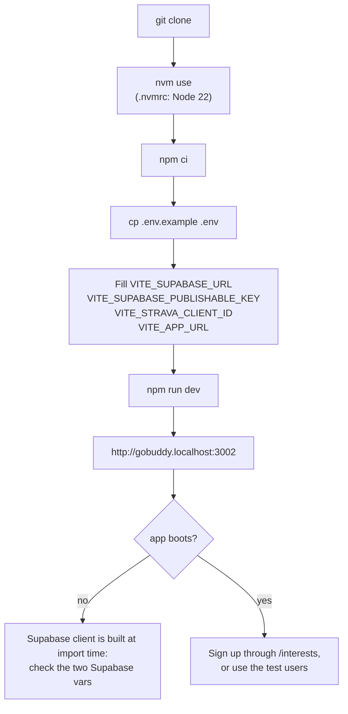
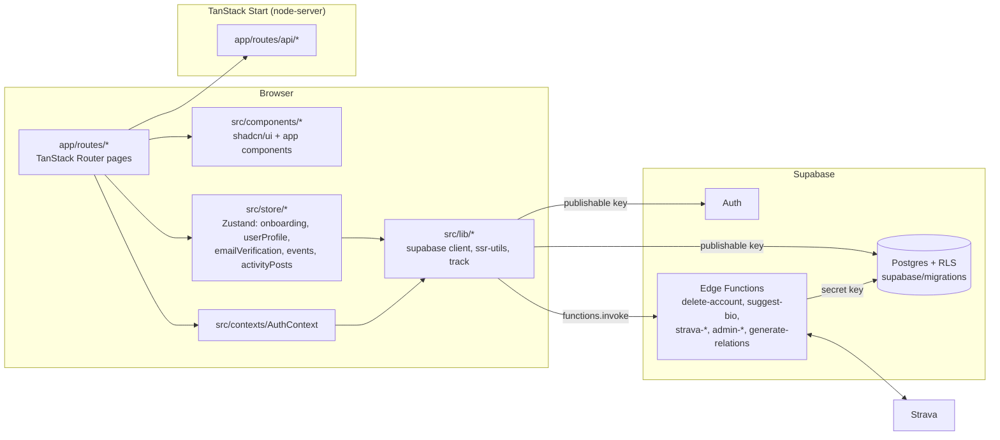
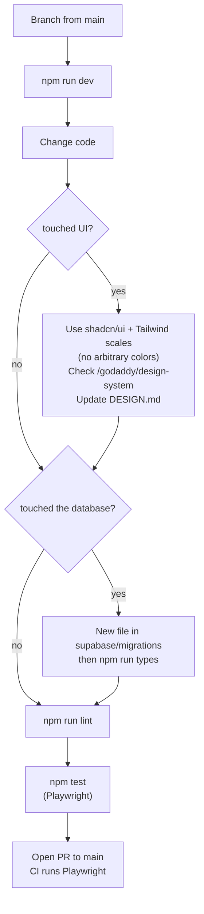

# New developer onboarding

From clone to a running app and green tests. See `CLAUDE.md` for conventions.

## 1. Setup

Optional, only when working on those features:

| Need | Variables / steps |
|---|---|
| Admin pages (`/godaddy/*`) | An account with the admin role |
| Strava integration | `VITE_STRAVA_CLIENT_ID`, Strava API app with callback domain = `VITE_APP_URL`, `STRAVA_CLIENT_SECRET` as a Supabase secret |
| Admin user generation | `VITE_CLAUDE_KEY` (semi-public, browser-shipped; do not reuse) |
| Edge Functions | `supabase secrets set --env-file=...` with `SB_SECRET_KEY`, `STRAVA_CLIENT_SECRET`, `STRAVA_WEBHOOK_VERIFY_TOKEN`, `CLAUDE_KEY` |

## 2. How the pieces fit

Rules of thumb:
- Browser-only code goes through `src/lib/ssr-utils.ts` (`isBrowser`, `useClientEffect`, `ClientOnly`) to avoid hydration mismatches.
- Anything needing the secret key (create/delete user, Strava code exchange) is an Edge Function, never client code.
- `app/routeTree.gen.ts` is generated. Do not edit it.

## 3. Daily workflow

Database changes: add a migration, then regenerate `database.types.ts` with `npm run types`. Tests that create real accounts need `SB_SECRET_KEY`; without it they skip (this is the case in CI).

## 4. Tests

| Command | What |
|---|---|
| `npm test` | Playwright, headless (starts `npm run dev` if not running) |
| `npm run test:ui` | Playwright UI debugger |
| `npm run storybook` | Storybook on port 6006 |

Test credentials (`TEST_USER_*`, `TEST_ADMIN_*`) go in `.env.test`. See `tests/README.md`.
