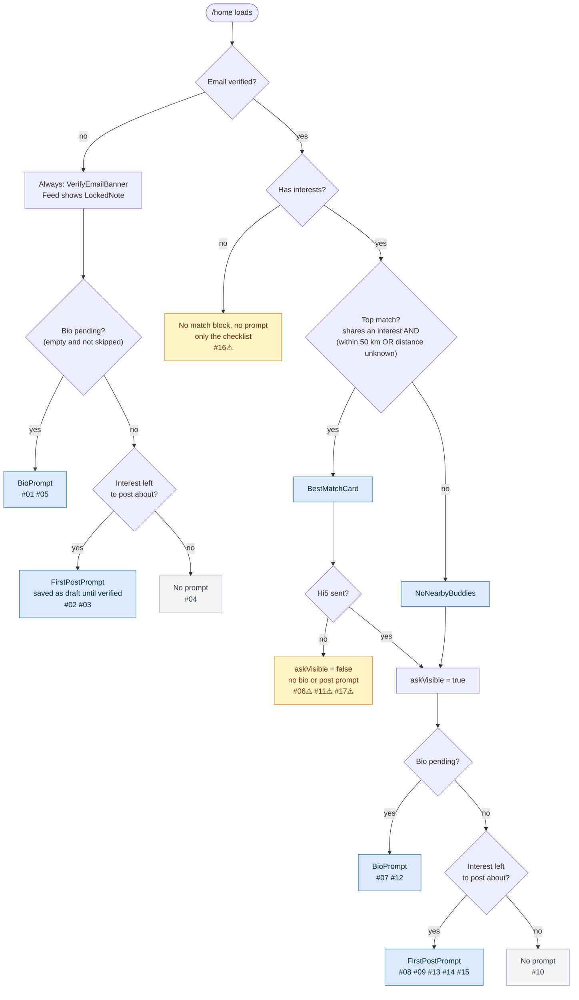
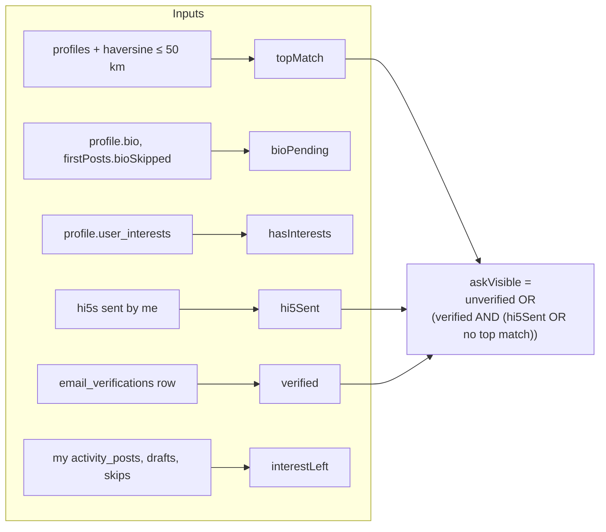

# /home prompts: decision tree

> Generated by `tests/scenarios/home-prompts.spec.ts`. Do not edit by hand: run
> `npx playwright test tests/scenarios/home-prompts.spec.ts` to refresh it.

Each end point lists the scenarios that landed there, placed by what the page rendered.
`#06` = scenario `06-…`, `⚠` = behavior worth a second look, `✗` = rendered something other than expected.
For the interactive version (pick a scenario, see its path and screenshot) open `docs/scenarios/home-prompts/index.html`.

## Worth a second look

- **#06⚠** Verified, match nearby, no Hi5 yet, no bio: the bio is never asked until a Hi5 is sent
- **#11⚠** Verified, match nearby, no Hi5, bio written: the first-post prompt stays hidden until a Hi5 is sent
- **#16⚠** Verified, no interests chosen: no interests means no prompt at all, only the checklist
- **#17⚠** Verified, no location set, buddy far away: without an own location, a buddy 155 km away is shown as the best match nearby

## State that drives it

