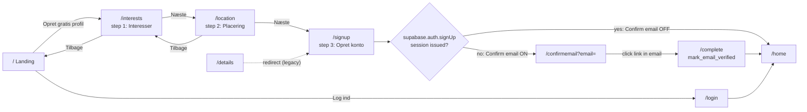
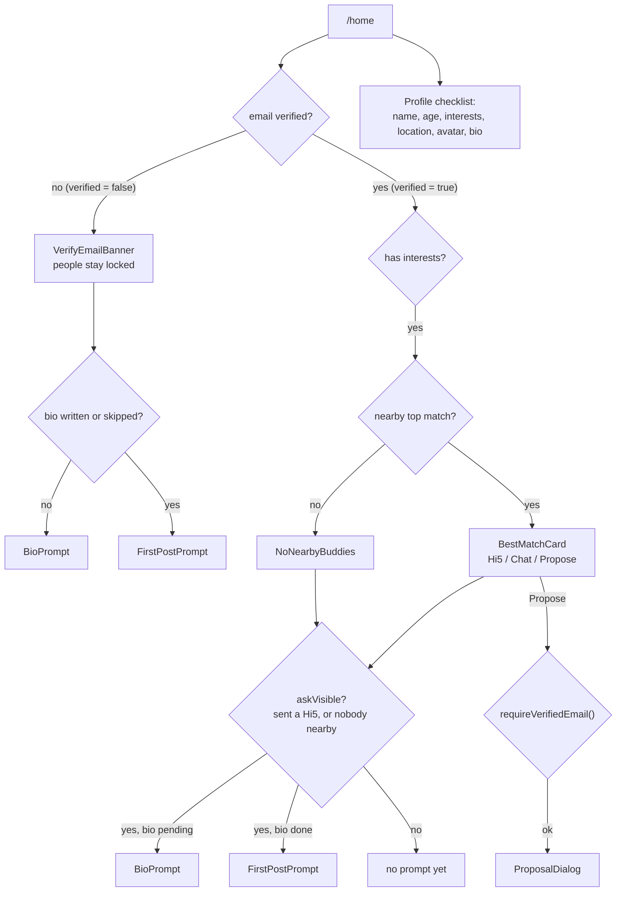
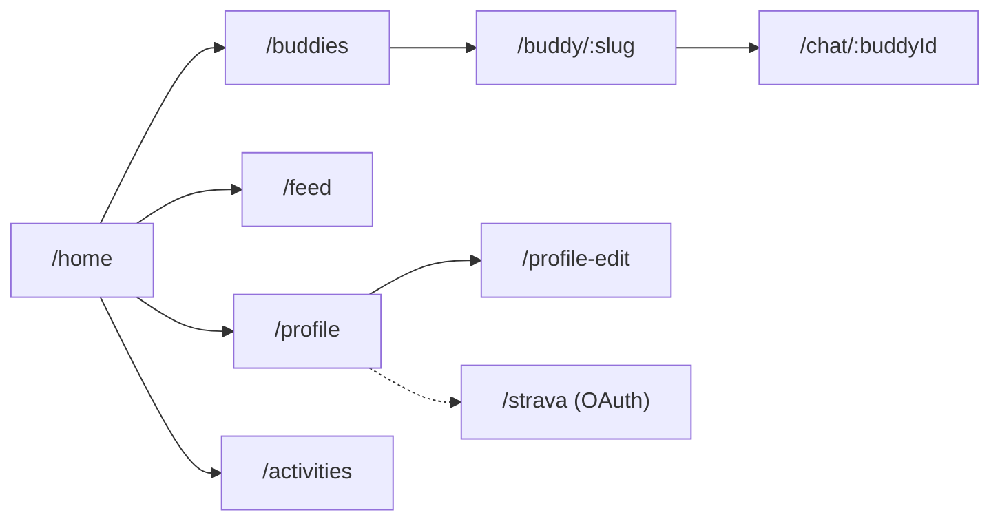

# New user flow

What a person sees from first visit to first match. Derived from `app/routes/` and `src/store/`. Update this file when a route's redirects or the home-page prompts change.

## 1. Onboarding (signup)

State lives in the persisted `useOnboardingStore` (localStorage) until signup, then `reset()` clears it. The stepper has 3 steps: Interesser → Placering → Opret konto.

Validation on `/signup`: password ≥ 8 characters, age ≥ `MIN_AGE` (18) and ≤ `MAX_AGE`.

## 2. First visit to `/home`

`/home` is wrapped in `ProtectedRoute` (redirects to `/` when logged out). What shows depends on `verified` (email proven) and on whether the profile has a bio.

Rules worth knowing:
- The bio is always asked before the first post.
- The bio checklist item is hidden while the `BioPrompt` card is on screen (one prompt is enough).
- `askVisible` is true when unverified, or verified and (a Hi5 has been sent or there is no top match).

## 3. After onboarding

Admin-only routes live under `/godaddy/*` (analytics, users, interests, design-system).
